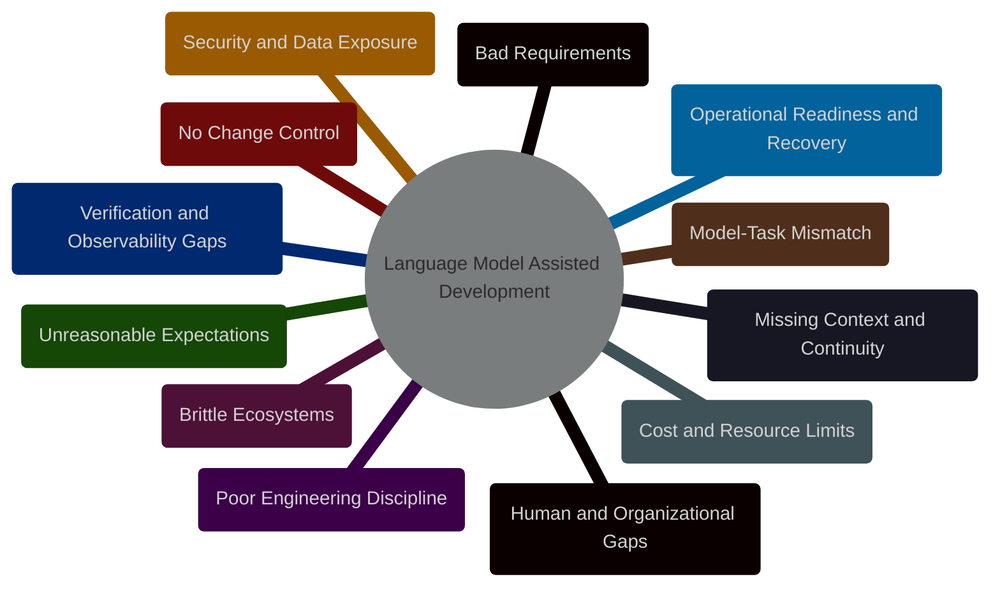

## The Model Is Not the Delivery Process

Language models can help us understand a codebase, investigate a failure, propose an architecture, write code, generate tests, and prepare operational changes. They can do those things quickly. They can also produce a plausible answer when the requirements are incomplete, the environment is misunderstood, or the evidence does not support the conclusion.

I use the term **Language Model Assisted Software Development** because the language model is assisting with software development. It is not replacing software engineering, operational ownership, or human accountability.

The same principle applies to operations. A model can help interpret logs, propose a configuration change, or prepare a deployment plan. It does not own the service, authorize the change, or know that a recovery procedure will work simply because it described one.

The question is not whether language models are useful. They are.

The question is whether the surrounding process can distinguish a useful contribution from an unverified assumption.

## Failure Has More Than One Source

When a model-assisted change fails, it is tempting to blame the model. Sometimes the model did make a poor choice. But the failure may also begin with an ambiguous request, missing context, a brittle dependency, an inadequate test, or a team that has not defined who owns the result.

These categories are not mutually exclusive. A single incident can involve several at once.

### Failure Map

| Potential failure | Example risk | Primary control |
| --- | --- | --- |
| **Bad Requirements** | An assumption becomes an unintended requirement. | Define scope and acceptance criteria. |
| **Brittle Ecosystems** | A change works locally but fails in the build environment. | Pin and verify the toolchain in the target environment. |
| **Cost and Resource Limits** | A budget or context limit interrupts work and loses continuity. | Set budgets and preserve session state. |
| **Model–Task Mismatch** | A model is selected without evidence it can handle the task. | Evaluate models against representative work. |
| **No Change Control** | Untracked changes expand scope and complicate rollback. | Track, review, and approve changes. |
| **Poor Engineering Discipline** | Generated code passes a narrow test but breaks intended behavior. | Apply design, testing, and review standards. |
| **Security and Data Exposure** | Sensitive data or untrusted instructions cross a boundary. | Use approved environments and least privilege. |
| **Unreasonable Expectations** | A plausible explanation is mistaken for a verified result. | Require evidence and human accountability. |
| **Missing Context and Continuity** | A new session misses an earlier decision or constraint. | Maintain durable decisions and handoffs. |
| **Verification and Observability Gaps** | A successful build is mistaken for a successful deployment. | Verify the actual outcome and retain evidence. |
| **Operational Readiness and Recovery** | A consequential change lacks monitoring or a rollback path. | Establish ownership, checks, and recovery procedures. |
| **Human and Organizational Gaps** | A team accepts outputs without clear ownership or review. | Define training, review, and escalation responsibilities. |

### 1. Bad Requirements

“Fix the deployment” describes an intention, not a complete contract. Which deployment? What behavior must remain unchanged? What evidence proves the fix? Who can approve it?

A model can fill gaps with plausible assumptions. That can get work moving, but an assumption can also become an unauthorized requirement.

The control is to define the objective, boundaries, acceptance criteria, and verification plan before implementation. When the answer depends on a product or operational decision, the model should surface the question rather than silently choose.

### 2. Brittle Ecosystems

Software delivery depends on operating systems, runtimes, package managers, dependencies, caches, browsers, network services, and deployment infrastructure. A change that works in one environment can fail in another.

Language models may recommend a familiar command without understanding the exact dependency graph or the state of a build runner. Repeating an install may encounter an incomplete artifact rather than repair it.

Pin and review the toolchain, reproduce the relevant environment where practical, and inspect the underlying failure before changing the workflow. A successful local command is useful evidence; it is not automatically evidence that the remote deployment works.

### 3. Cost and Resource Limits

Model usage has limits: spending budgets, rate limits, context windows, output limits, and session duration. These are related but different problems. A session can lose necessary context without exceeding its budget, and a team can exhaust a budget while context still fits.

When a task is interrupted, the risk is not only the cost of another request. It is unfinished work, lost reasoning, repeated investigation, or an incomplete handoff.

Define budgets appropriate to the task. Break work into reviewable units, preserve decisions and current state outside the conversation, and make interruption and resumption part of the workflow.

### 4. Model–Task Mismatch

The largest or most expensive model is not necessarily the best choice for every task. A smaller model may be effective for a bounded transformation; a difficult architectural investigation may require stronger reasoning and more context. Some tasks should use deterministic tools instead of a model at all.

Model selection should consider the task, data restrictions, quality requirements, latency, cost, and failure consequences. Evaluate on representative work rather than relying only on a model name or a compelling demonstration.

### 5. No Change Control

A model can identify adjacent improvements while implementing the requested change. Some are valuable. They are not automatically in scope.

Without change control, an investigation can become a dependency upgrade, an architecture change, and a deployment revision in one unreviewable diff. The team may not know which change caused the outcome or how to reverse it.

Use an issue, a bounded change list, human ownership, and an explicit review of architectural or behavioral changes. Record new discoveries separately instead of absorbing them silently.

### 6. Poor Engineering Discipline

Generated code still needs the same engineering scrutiny as handwritten code. It can duplicate existing behavior, hide errors, introduce unnecessary abstractions, break compatibility, or pass tests that do not exercise the real requirement.

The control is not to distrust every line by default. It is to require understandable changes, appropriate tests, review, maintainable interfaces, and evidence that the intended behavior is preserved.

### 7. Security and Data Exposure

Model-assisted work can expose source code, credentials, customer information, logs, or operational details to a provider. A tool-enabled assistant may also encounter untrusted instructions in documents, repositories, or external responses.

Use approved providers and environments, minimize and sanitize context, and grant only the access needed for the task. Treat external content as data, not authority. Require human authorization for consequential actions, and apply normal security review to the resulting changes.

### 8. Unreasonable Expectations

A language model can produce a confident explanation without having verified it. It may say a fix is complete after changing a file, even though no build ran or the deployment was not tested.

The opposite expectation is also unhelpful: assuming every model-assisted change is inherently unusable. The standard should be evidence, not enthusiasm or dismissal.

Ask what was changed, what was tested, what remains unknown, and who accepted the residual risk.

### 9. Missing Context and Continuity

Important information can be scattered across issues, code, documentation, logs, and conversation history. A model may use stale instructions, miss an earlier decision, or lose detail when a long session is summarized.

Maintain durable project guidance, decisions, acceptance criteria, and a current work queue. A new session should be able to identify what was completed, what is blocked, and what needs verification without reconstructing the entire conversation.

### 10. Verification and Observability Gaps

A green unit test does not prove that a deployment succeeded. A completed build does not prove that users can reach the new version. A model's summary does not prove that the command it described actually ran.

Validation should match the claim. Preserve command results, relevant logs, test outcomes, and the environment in which they ran. Distinguish an observed success from an assumption, and an infrastructure failure from a product failure.

### 11. Operational Readiness and Recovery

Operations introduce consequences beyond the code diff. A proposed configuration can affect live traffic, data, access, cost, or availability.

Before a consequential change, establish the target environment, authorized scope, expected impact, verification checks, and rollback or recovery path. Use least privilege and human approval appropriate to the risk. An assistant can prepare a runbook; the service owner must decide whether it is safe to execute.

### 12. Human and Organizational Gaps

Tools do not compensate for unclear ownership or an organization that rewards speed while ignoring rework and incidents. Reviewers may accept a fluent explanation without checking it. Teams may use different providers or approaches without shared standards.

Set expectations for training, review, escalation, and ownership. Measure outcomes across the team rather than assuming that a productive individual workflow is ready for enterprise adoption.

## An Anonymized Deployment Example

*Editorial note: This example was observed in November 2026, after the date of this post. Identifying details have been omitted.*

A publishing pipeline failed because a browser executable needed for the build was missing. A sequence of model-assisted changes attempted to resolve the problem. A subsequent run failed because a browser installation directory existed without the expected executable.

The logs established that the installation was incomplete. They did not establish why the directory was incomplete. A plausible explanation was not the same thing as a confirmed root cause.

The useful response was to step back and separate the questions:

1. Which browser does the build actually require?
2. When and where is that browser installed?
3. Can the workflow verify the executable before starting the build?
4. Does the clean build work in the target environment?
5. Does the publishing step complete and produce the expected site?

This is not a story about one model failing a simple task. It is an example of ecosystem dependencies, incomplete evidence, and a verification boundary. A change to an installer is not a successful deployment until the intended workflow has been tested. Local validation can reduce uncertainty, but the remote build and publishing result still need their own evidence.

## A Maturity Expectation

In my [Intelligent Control Process](https://markrox.ai/AppliedAI/2026/06/29/intelligent-control-process/), the objective is decision-aware, traceable, and reviewable delivery. The process connects intake, planning, implementation, review, verification, deployment, and closeout, with human responsibility throughout.

That process provides a foundation for a maturity expectation for Language Model Assisted Software Development and operations:

| Level | Expectation | Evidence |
| --- | --- | --- |
| **Exploratory** | Individuals use approved tools on bounded work; a human reviews the result. | A known owner, an identifiable change, and a record of what was checked. |
| **Controlled** | Teams define scope, approved environments, change tracking, review, and verification before implementation. | Linked work items, acceptance criteria, reviewed diffs, and recorded test results. |
| **Operational** | Development and operations use shared controls, observability, and risk-based deployment and recovery practices. | Access and cost controls, release evidence, service ownership, monitoring, and tested recovery procedures. |
| **Optimizing** | Teams evaluate models and workflows against representative tasks and improve their controls using observed outcomes. | Evaluation results, trend measures, incident learning, and documented changes to the process. |

These levels describe a practical progression, not a certification. A team may be operational in development but still exploratory in production operations. Assess those areas separately, and do not assume that a more autonomous workflow is automatically more mature.

The expectation should also be proportional to risk. A draft documentation change and a production database migration do not need identical approval paths. Both need an owner and verification appropriate to their consequences.

## What Should We Measure?

Activity is not the same as value. The number of prompts submitted, lines generated, or changes merged does not tell us whether the outcome was reliable.

More useful measures include:

- **Delivery outcomes:** lead time, rework, escaped defects, and change failure rate.
- **Verification:** whether acceptance criteria were met and results were captured in the relevant environment.
- **Operations:** deployment success, recovery time, and whether rollback procedures have been tested.
- **Security and governance:** exceptions, access scope, data handling, and review completion.
- **Model effectiveness and cost:** task success, human review effort, model usage, and cost per useful outcome.

These measures need context. A team handling higher-risk systems may appropriately take longer to release. Use metrics to identify learning opportunities, not to reward volume or encourage teams to hide failures.

## Maturity Is Evidence, Not Autonomy

Language Model Assisted Software Development can increase reach and accelerate delivery. It can also amplify weak requirements, fragile workflows, and unexamined assumptions.

The mature response is not to remove humans from the process. It is to make the work clear enough to review, constrained enough to operate safely, and observable enough to know whether it succeeded.

The model assists. The team owns the outcome.

### References

- [Intelligent Control Process](https://markrox.ai/AppliedAI/2026/06/29/intelligent-control-process/)
- [Enterprise AI Maturity Model](https://markrox.ai/AI%20Strategy/2025/07/24/ai-maturity-model/)

### Image Credit

Photo by [Kevin O'Connor](https://unsplash.com/@kevin_1000x) on [Unsplash](https://unsplash.com/photos/woman-walking-in-hallway-JxSLigoB-6A), reused from the Enterprise AI Maturity Model post.
